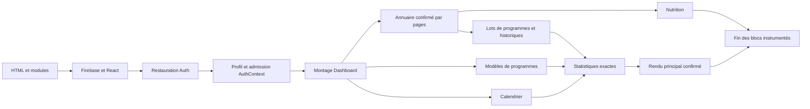

# Lot 8B — chemin critique du Dashboard Coach

## Méthode

La vraie application, AuthContext, le SDK Firestore mémoire et les routes API sont exécutés dans des copies temporaires, sur le projet émulateur `demo-byl-performance`. Aucun compte réel. Chrome headless dispose d’un profil jetable par volume ; l’application du navigateur utilisateur n’est pas pilotée.

Le banc distingue : navigation HTML (Navigation Timing), fin d’évaluation du module Firebase, entrée JavaScript, restauration Auth, observation de session, admission du profil, navigation du routeur, montage du Dashboard, racines, modèles, calendrier, enrichissement des programmes, statistiques `core`, nutrition et deux frames `painted`. Ces horloges sont locales à la page ; `mountMs` est relatif au Dashboard. Les instants Firebase/entrée sont des fins de module, pas un profil CPU exhaustif de chaque import. L’initialisation React n’est pas isolée comme une durée autonome : coque affichée et montage du Dashboard en sont les bornes observées.

Les marqueurs existants restent opt-in. L’instrumentation Auth et les sondes Long Tasks/heartbeat sont injectées uniquement dans la copie de qualification. Elles n’enregistrent ni tokens ni données privées de production. Les mesures brutes sont dans `audits/lot8b/`.

## Dépendances

L’annuaire partiel permet déjà un premier affichage. La confirmation des statistiques globales attend tous les dossiers et leurs historiques : le premier nom affiché ne prouve pas leur disponibilité. Les modèles et le calendrier disposent de chemins indépendants. La nutrition peut continuer après le principal.

## Trois causes principales démontrées

1. **Vagues de requêtes de programmes.** Avant : huit dossiers par POST, trois POST au maximum simultanément. À 500 dossiers : 63 requêtes de détail, à 1 000 : 125. Chaque transaction refait l’admission et contrôle chaque racine. Ce coût de coordination et ses aller-retours se cumulent sur le chemin critique. Après : 32 dossiers par POST, toujours trois requêtes simultanées, soit 16 et 32 POST. Aucune permission n’est remplacée par un cache ; aucune donnée n’est approximée.
2. **Remontages React répétés.** StatTile, QuickMetricCard et PriorityCard étaient des types recréés dans le corps du Dashboard. Le passage Lot 8A à 500 dossiers comptait 704 montages StatTile et 616 QuickMetricCard. Un composant de type stable reçoit maintenant les callbacks de rendu actuels. Les sous-arbres gardent leur identité et les handlers ne conservent pas une ancienne fermeture. L’essai isolé montre une baisse importante des montages mais pas de gain significatif du temps principal : il ne suffit pas à résoudre les aller-retours réseau.
3. **Travail global proportionnel au portefeuille.** L’annuaire est parcouru par pages dépendantes ; tous les programmes et historiques nécessaires aux statistiques exactes sont chargés ; la nutrition interroge même les collections vides. Ce travail explique les lectures et le CPU résiduels. Il n’est pas supprimé sans preuve de synthèses fiables. Les grosses données et le démarrage Vite sous réseau/CPU ralentis restent distincts de la latence Firebase.

## Portée des jalons

- Premier contenu utile : apparition d’une donnée synthétique autorisée, pas un skeleton.
- Première statistique confirmée : disponibilité des racines complètes, distincte des statistiques de progression confirmées à `core`.
- Clients récents / programmes : racines et détails / modèles sont mesurés séparément ; les noms peuvent apparaître avant les actions dépendantes des historiques.
- Calendrier : coque, premier événement visible et marqueur du composant ; cela ne certifie pas chaque opération métier.
- Principal : `core` prêt, observé après commit React ; les totaux terminés/prévus sont conservés dans les preuves.
- Tous les blocs instrumentés : `painted` après core/nutrition/préférences/copilot. Les routes secondaires non montées peuvent retourner 404 : ce n’est pas une preuve de chargement exhaustif de toute l’application.
- Interactivité : Long Tasks et délai maximum du heartbeat 50 ms. Ce n’est pas une mesure INP terrain ni une preuve que chaque bouton fonctionne.

La restauration ne contourne pas l’admission : le banc attend la confirmation de la session privée avant de naviguer, et le rafraîchissement utilise la restauration Firebase réelle. Aucune suppression de contrôle Auth n’a été retenue.

## Profil CPU sous ralentissement ×4

La sonde CDP Profiler est activée dans les deux séries CPU, avec le même coût de mesure. Elle conserve les 30 frames de temps propre les plus coûteuses dans `cpuSelfTopMs`. Sur la référence 500, le principal arrive vers 25 s ; les frames propres incluent le corps du Dashboard (~1,58 s), ReactElement (~0,85 s), interpolation de styles et i18n. Les frames anonymes des dépendances ne sont pas attribuées arbitrairement à Firebase. Les durées propres ne sont pas les durées inclusives et ne doivent pas être additionnées à la latence des requêtes. Les Long Tasks atteignent 376 ms dans ce passage : l’interface n’est donc pas garantie sans blocage pendant tout le chargement.

## Confirmation des valeurs affichées

Les compteurs de la vue initiale ont été qualifiés séparément du premier nom affiché. Un préfixe d’annuaire ne doit pas apparaître comme un total confirmé. La version finale affiche une attente (`aria-busy`) pour le total clients jusqu’à confirmation des racines, pour les programmes jusqu’au résultat de leur source, pour la nutrition jusqu’à sa disponibilité, et pour les statistiques d’activité jusqu’à core et calendrier confirmés. Les sous-titres numériques d’une statistique encore partielle sont également différés. Les liens et actions restent utilisables. Ce changement ne lit aucun document supplémentaire et ne sert pas à arrêter le chronomètre plus tôt.

### Admission et mises à jour ultérieures du profil

Dans les traces collectées, `profileAuthorized` et `profilePublished` sont les **dernières** confirmations observées, car le profil peut être republié. Elles ne mesurent pas la première admission et peuvent se situer après core. Les tableaux utilisent `startup.admitted`, premier contrôle positif de la session privée par le banc (précision de sondage 100 ms), suivi de la navigation. Ce marqueur inclut l’attente du banc, pas seulement le temps CPU d’AuthContext. La sonde est corrigée pour préserver la première occurrence lors des futurs passages ; les traces existantes ne sont pas réécrites.
